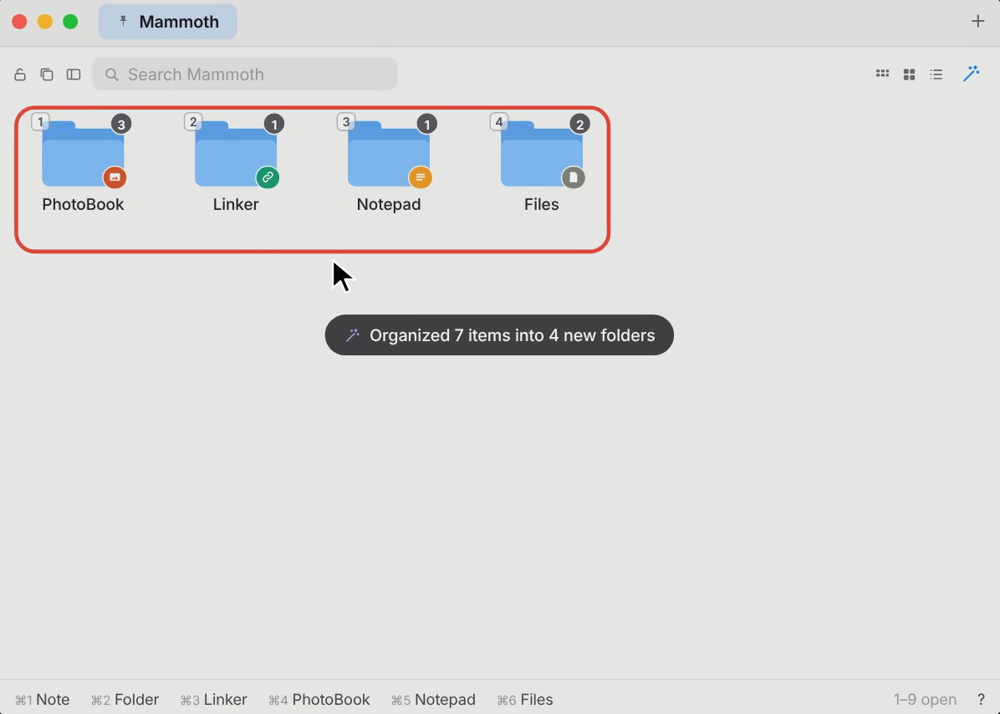
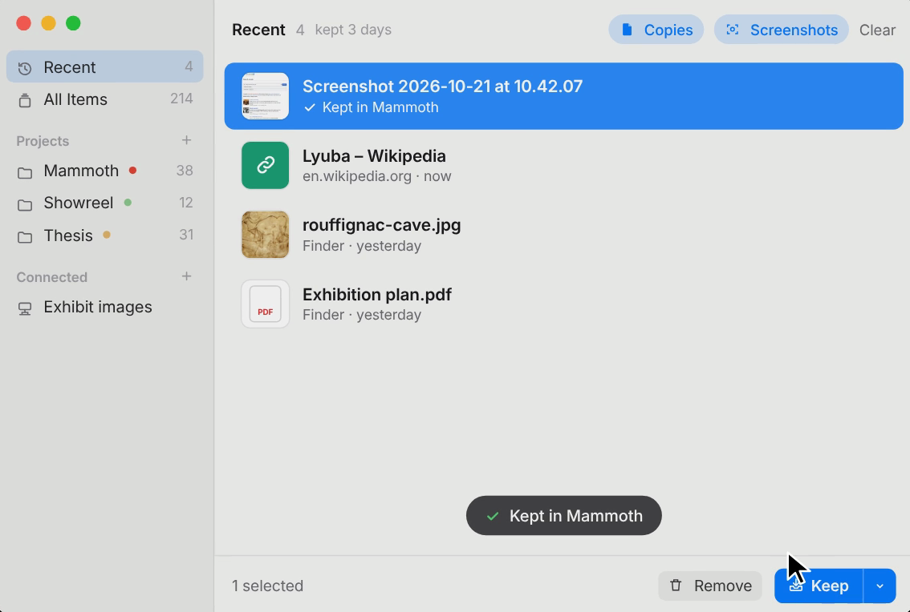
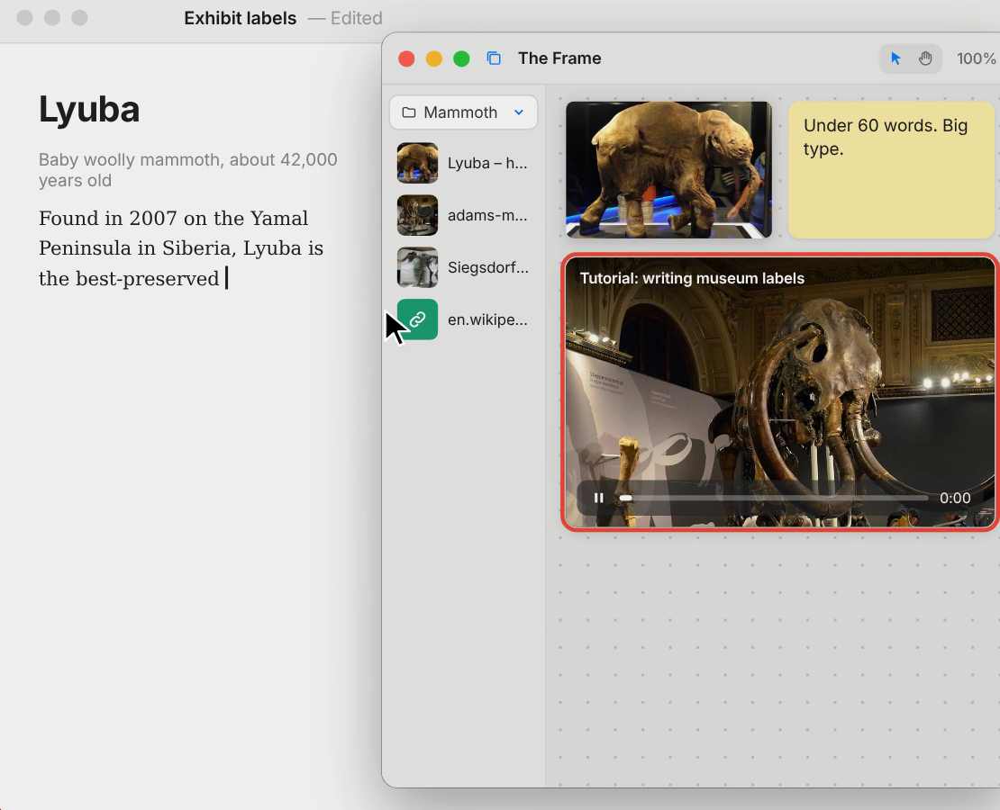

<p align="center"></p>

<h1 align="center">Swiss</h1>

<p align="center">A Mac menu bar app for keeping links, pictures, files and notes close while you work.<br>
<a href="https://swiss-kohl.vercel.app">Website</a> · <a href="docs/SECURITY.md">Security</a> · <a href="docs/CHANGES.md">Changes</a></p>

<p align="center"></p>

## Features

- **Projects.** Drop, paste or drag things in from any app. Each project is a tab, with folders for links, pictures, notes and files.
- **Recent.** Optional capture of what you copy, screenshot and download. Off until you turn it on.
- **Magic wand.** Sorts a busy board into folders by kind.
- **Connected folders.** Work in a Finder folder like a project; changes happen in the real folder.
- **The Frame.** A canvas that floats above every app, for pictures, notes, links and videos.
- **Convert and share.** Right-click to convert images, video, audio and documents, or to share.

<p align="center">
  
  
</p>

## Requirements

macOS 14 or later on Apple silicon. Building needs Xcode (Swift 5.10 or later).

## Install

There's no signed download yet. Build it from source:

```bash
git clone https://github.com/yotamkiper1/Swiss.git
cd Swiss
./build.sh install
```

`./build.sh install` builds the app, copies it to Applications and opens it. Press **⌥Space** to open Swiss from anywhere.

## Keys

| Keys | Action |
|---|---|
| ⌥Space | Open or close Swiss |
| ⌥⌘V | Save what you copied, from any app |
| ⌘1 – ⌘6 | New note, folder, Linker, PhotoBook, Notepad, Files |
| ⌃Tab | Next project |
| Space | Quick Look |
| ? | Every button and key |

## Privacy

Swiss has no account, no server and no analytics. Your library is ordinary files in `~/Documents/.Stash`, and Swiss only goes online for things you ask for, like a saved link's title. Clipboard capture is off by default and never keeps passwords. Details are in [docs/SECURITY.md](docs/SECURITY.md).

## Development

```bash
./build.sh          # build/Swiss.app
./build.sh test     # build/Swiss Test.app, a separate copy with its own library
```

| Path | Contents |
|---|---|
| `Sources/Stash` | The app (SwiftUI and AppKit) |
| `Resources` | Icon, Info.plist, entitlements, bundled `yt-dlp` and `lame` |
| `site` | The website ([site/README.md](site/README.md)) |
| `extras/chrome` | The Chrome right-click extension |
| `tools/film` | The promo film, made in code |
| `docs` | Security, releasing, design notes |

The project keeps its earlier name, Stash, in a few places (bundle id, folder names, the `stash://` scheme) so existing libraries carry over.

## Feedback

Help ▸ Send Feedback in the app, or kipery20@gmail.com.
