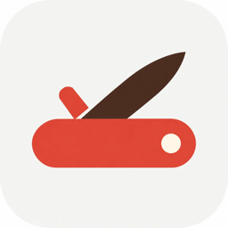
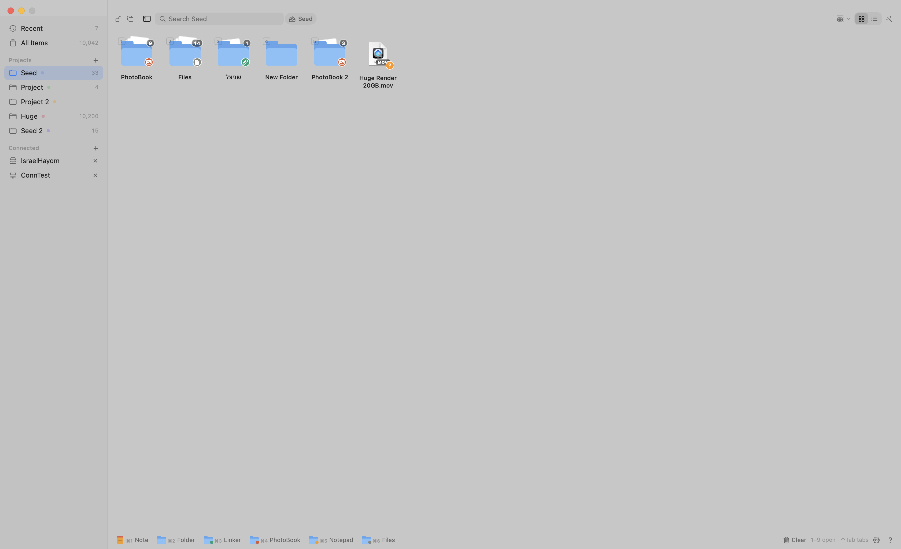
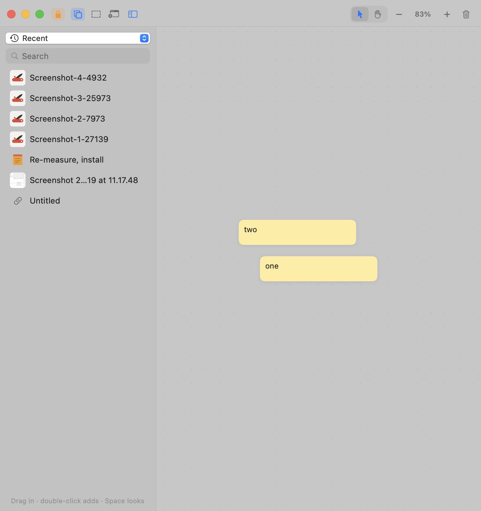
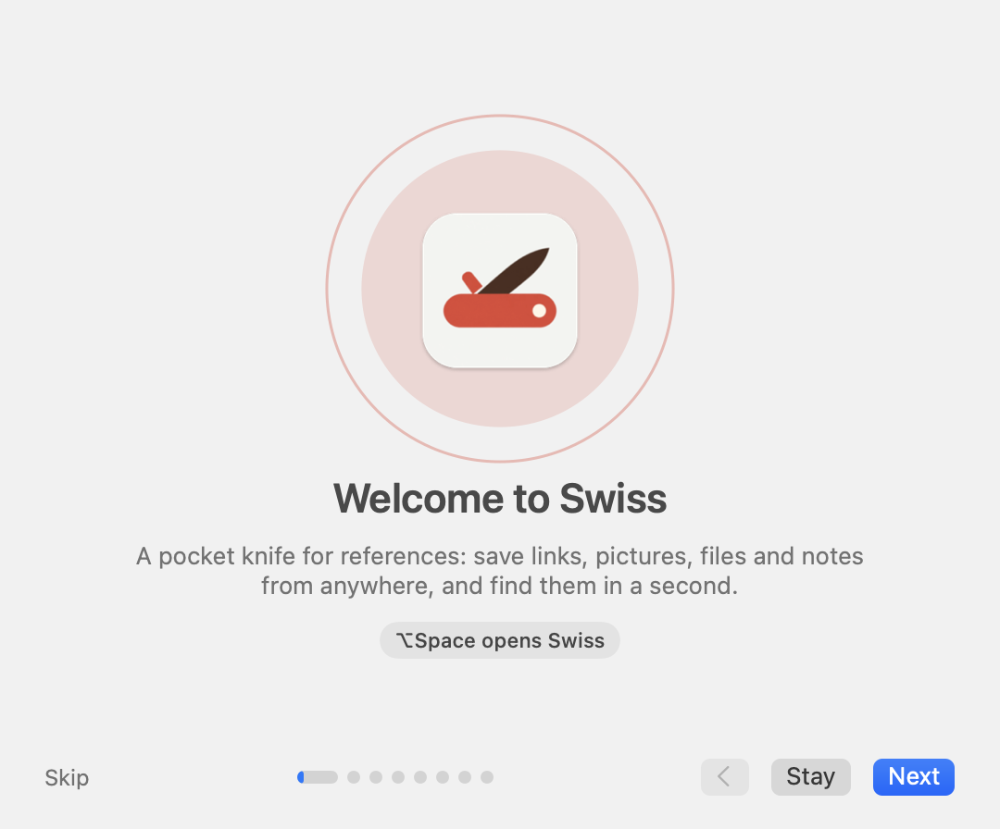

<p align="center"></p>

# Swiss

**A pocket knife for your ideas.** Swiss is a macOS menu bar app for collecting what you find while you work — links, pictures, files, notes — and finding it again in a second. Everything stays on your Mac: no account, no cloud.

<p align="center">
  
</p>
<p align="center">
  
  
</p>

## What it does

- **Projects as tabs.** Drop, paste or drag things in; organize with folders (Linker, PhotoBook, Notepad, Files), notes, tags and drag-and-drop. Copy and paste whole folders between projects.
- **Recent.** Optional capture of what you copy and screenshot; one tap keeps an item in a project. Off until you turn it on.
- **The magic wand.** Sorts a messy board into folders by kind.
- **Connected folders.** Work in any Finder folder like a project — rename, move, tag, sort. Changes happen in the real folder.
- **The Frame.** A free canvas above every app: pictures, notes, links, YouTube and video, zoom, pan, ⌘Z undo, and a library to pull items in from.
- **Convert.** Right-click → Convert: images (HEIC, PNG, JPEG…), video and audio (MP4, MP3…), documents to PDF. YouTube links can be saved as MP3/MP4.
- **Three sizes.** Pop-up, window, full screen — the green button steps up, orange steps down.
- **Safe by default.** Deleted items stay recoverable for 30 days; saves are crash-safe with automatic backups.

## Install

Requires macOS 14+ and Xcode (Swift 5.10+).

```bash
./build.sh            # builds build/Swiss.app
./build.sh install    # also copies it to /Applications and launches it
./build.sh test       # builds "Swiss Test", a separate copy for testing (own library and settings)
```

Open it from the menu bar icon or with **⌥Space**. The first launch shows a short welcome tour (Help → Welcome Tour to see it again).

## Essential keys

| Keys | Does |
|---|---|
| **⌥Space** | Open or close Swiss |
| **⌥⌘V** | Quick save what you copied, from any app |
| **⌘V** · **⌘C** | Paste into the current project or folder · copy cards and folders (pasting makes numbered copies, e.g. "Poster 2") |
| **⌘1 – ⌘6** | New note · folder · Linker · PhotoBook · Notepad · Files |
| **1 – 9** | Open the folder with that number |
| **⌃Tab** | Next project tab |
| **⌘A / ⌃A** · **⇧-click** | Select all · select a range |
| **Space** | Quick Look |
| **⌘⌫** · **⌘Z** | Delete · undo |
| **?** (bottom right) | Lists every button and key |

Tabs close with **×** (the project stays); projects are deleted from All Projects or the sidebar.

## Where your data lives

```
~/Documents/.Stash/            your library as real files and folders (hidden)
    <Project>/<Folder>/…         pictures and files, notes (.txt/.rtf), links (.webloc)
    .stash/                      Swiss's own data: library.json, backups, trash (30 days)
~/Library/Application Support/Stash/   settings and tools
```

Moving, renaming and deleting in Swiss does the same to the files. Very large files (default: over 250 MB) are linked, not copied, so they never fill your disk.

## Privacy and safety

- Nothing of yours is uploaded. Swiss only contacts a site to fetch a saved link's title and picture, or to download something you asked for.
- Capture of the clipboard and screenshots is **off** until you enable it (Settings → Capture); Recent keeps items 3 days by default.
- Files are checked before they run (code-like files ask first), downloads are quarantined like Safari's, and the downloader runs without user config.
- Saves are written in the background, verified, and swapped in atomically; the last good copy and hourly backups are kept.

## Updates

- Share: right-click anything (or use Share in the picture preview) for AirDrop, Mail, Messages and more; WhatsApp is added to the list.
- The "you copied…" banner now disappears after 15 seconds or when you move to another project or folder.
- Welcome tour on first launch.
- Copy/paste of cards and folders inside Swiss, with numbered names.
- The Frame: ⌘Z undo, a library panel, and a companion window.
- Connected folders in sync with Finder (arrange by name, kind, date, tags).
- Faster project switching and instant selection, even with 10,000 items.

## For developers

| Path | Contents |
|---|---|
| `Sources/Stash/` | The app (SwiftUI + AppKit): `Store.swift` (state), `Panel.swift` (windows, keys), `Canvas.swift` (the Frame), `ConnectedEdit.swift` (connected folders), `RecentStore.swift`, `Views/` |
| `Resources/` | Icon, Info.plist, entitlements, bundled `yt-dlp` and `lame` |
| `tools/film/` | The commercial film, made entirely in code (see its README) |
| `docs/` | Screenshots and design notes |

Swiss Test only: `stashtest://debug…` links drive test hooks (`DebugHooks.swift`); the real app ignores them. The bundle id, folder names and `stash://` scheme keep their old "Stash" names so existing libraries carry over; `swiss://` works too.
